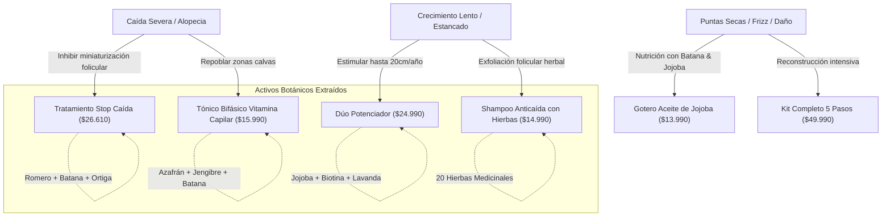

# 🌿 Brand Identity & Design System: Rapunzel Organic

Documento maestro de ingeniería de marca, arquitectura de información y sistema de diseño botánico de alta conversión para **Rapunzel Organic** (Chile), derivado de extracción multimodal 100% auténtica de su cuenta oficial de Instagram `@rapunzel_organic`.

---

## 1. ADN, Propósito y Copywriting de Marca

### 1.1 Declaración de Misión y Esencia
> **"Cuida tu cabello con amor • Natural, Orgánico, Efectivo"**

**Rapunzel Organic** es la marca botánica líder en Chile en fitoterapia capilar y recuperación de áreas despobladas, con una comunidad de más de **150.000 clientas verificadas** y **288.000 seguidores en Instagram**. Su diferencial absoluto frente a la cosmética industrial masiva es el uso de **más de 20 hierbas medicinales molidas en infusión**, extractos botánicos puros (Batana Oil, Romero, Azafrán, Ortiga, Cola de Caballo, Jojoba) y fórmulas 98% orgánicas sin sulfatos agresivos ni testeo animal.

### 1.2 Tono de Comunicación y Copywriting Heurístico
- **Tratamiento personal:** Femenino, cercano, contenedor y respetuoso (*"¡Hola bella!", "Querida comunidad"*).
- **Autoridad Botánica:** Explicaciones biológicas claras y transparentes (ej. por qué el tónico es bifásico y debe agitarse, por qué el azafrán varía de color y por qué el shampoo contiene finos restos de hierbas molidas).
- **Validación Social Constante:** Destaca testimonios reales, conversaciones sin filtros de WhatsApp y cambios de 1 a 4 meses en casos severos (alopecia nerviosa, postparto/lactancia, cirugías bariátricas, recuperación capilar masculina).

---

## 2. Paleta Cromática Extraída Matemáticamente

Colores obtenidos mediante análisis espectral y ColorThief sobre el isotipo botánico, packaging real y plantillas de feed:

| Rol de Color | Nombre Visual | HEX Code | Aplicación UI |
| :--- | :--- | :--- | :--- |
| **Primario Botánico** | Romero Profundo | `#5B6434` | Botones CTA principales, bordes activos, títulos H1/H2 |
| **Primario Hover** | Musgo Bosque | `#3B4220` | Estados hover y focus de botones primarios |
| **Secundario** | Salvia Herbal | `#9BA75A` | Badges, tags de ingredientes, fondo de quiz |
| **Acento Femenino** | Lavanda / Lila Orgánico | `#91749D` | Tags de tratamiento, detalles de isotipo, bordes suaves |
| **Acento Óleo** | Ámbar / Batana Gold | `#C87A38` | Etiquetas de gotas, precios destacados, estrellas |
| **Fondo Principal** | Lino / Crema Natural | `#FBF9F7` | Fondo global de la web (`bg-[#FBF9F7]`) |
| **Superficie Tarjetas** | Blanco Puro | `#FFFFFF` | Tarjetas de producto, drawer de carrito, modales |
| **Superficie Suave** | Avena Botánica | `#F3EFEA` | Secciones alternas, contenedores de beneficios |
| **Texto Principal** | Carbón Botánico | `#1A1A18` | Tipografía principal (WCAG AAA sobre fondos claros) |
| **Texto Secundario** | Ceniza Herbal | `#5A5954` | Subtítulos, descripciones, términos y condiciones |
| **Borde Sutil** | Arena Cálida | `#E4DFD7` | Separadores de cards e inputs de formulario |

---

## 3. Jerarquía Tipográfica y Reglas UI/UX (`ui-ux-pro-max-skill`)

- **Tipografía de Display / Títulos:** `Playfair Display` (serif de alta gama, editorial, botánico, femenino).
- **Tipografía de Interfaz / Lectura:** `Plus Jakarta Sans` / `Inter` (sans-serif legible, neutro, moderno y limpio).
- **Micro-interacciones y Estados:**
  - Botones con escala suave (`active:scale-[0.98] transition-all duration-200`).
  - Animaciones de entrada escalonadas con `framer-motion` (fade-in + slide-up).
  - Feedback inmediato al añadir al carrito con toast flotante o drawer slide-in.
  - Diseño 100% Mobile-First optimizado para navegación con una sola mano desde Instagram.

---

## 4. Grafo de Conocimiento Multimodal (`Graphify`)

Mapeo de interdependencias entre Necesidades Capilares, Principios Activos y Productos Formulados:

---

## 5. Datos de Conversión y Embudo de Ventas WhatsApp

- **Número Oficial WhatsApp:** `+56 9 5367 2027`
- **Enlace de Checkout:** `https://wa.me/56953672027?text={MENSAJE_CODIFICADO}`
- **Estructura del Mensaje Autogenerado:**
  1. Saludo cálido: *"¡Hola equipo Rapunzel Organic! 🌿 Quiero realizar mi pedido desde el catálogo web:"*
  2. Lista detallada con emojis, nombres de productos, formato y subtotal en CLP.
  3. Total final a pagar.
  4. Datos de despacho de la clienta (Nombre, Teléfono, Comuna, Región, Dirección).
  5. Consulta de método de pago (Transferencia o Tarjeta).
